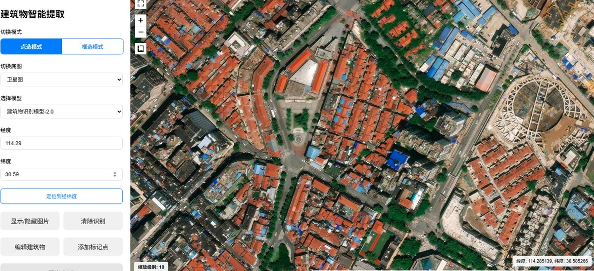

<div align="center">

# Img2Building

**基于深度学习的卫星影像建筑物智能识别与GIS 导出工具**

框选一片区域，自动提取建筑轮廓，一键导出 Shapefile

[](https://www.python.org/)
[](https://fastapi.tiangolo.com/)
[](https://vuejs.org/)
[](https://pytorch.org/)
[](LICENSE)

[English](README_EN.md) | 简体中文

</div>

---

## 这是什么

在卫星底图上**框选或点选**任意区域，深度学习模型自动识别范围内的建筑物轮廓，导出为 **Shapefile (SHP)** 等标准 GIS 格式，直接拖进 QGIS / ArcGIS 继续作业。

不需要手工描边，不需要付费 API，识别结果可以直接进入你现有的 GIS 工作流。



> 上图：左键点选 + 经纬度定位（114.29, 30.59）识别结果，蓝色为自动提取的建筑轮廓矢量。

## 能干什么

| 能力 | 说明 |
|---|---|
| 框选识别 | 鼠标拖拽矩形区域，批量提取范围内全部建筑轮廓 |
| 点选识别 | 单点定位，提取该坐标处的建筑物 |
| 经纬度定位 | 直接输入经纬度跳转识别，适合按坐标清单批量处理 |
| 矢量导出 | 导出 SHP，含完整 GIS 属性结构 |
| 结果编辑 | 支持手动编辑轮廓、增补标记点，人工修正模型漏检误检 |
| 多底图 | 卫星影像 / 街道图切换，辅助判断建筑边界 |

## 技术栈

**前端** Vue 3 + TypeScript + Vite 4 + Leaflet 1.9（地图交互）
**后端** FastAPI + PyTorch（模型推理）
**数据** 自建数据集，8000+ 张卫星影像及标注

## 项目状态

| 模块 | 状态 |
|---|---|
| 地图交互与界面 | 进行中 |
| 模型训练与推理 | 进行中 |
| 后端 API 服务 | 开发中 |
| 矢量导出 | 开发中 |

项目正在重写中，功能逐步上线。欢迎提 Issue 提需求。

## 快速开始

### 前端

```bash
cd frontend/vue_project

# 推荐用 nvm 管理 Node 版本（Windows）
# https://github.com/coreybutler/nvm-windows/releases
nvm install 18.17.0
nvm use 18.17.0

npm install
npm run dev      # 开发模式
npm run build    # 生产构建，产物在 dist/
```

### 后端

```bash
cd backend
pip install -r requirements.txt
uvicorn main:app --reload
```

### 获取模型

模型权重（`img2building_model.pth`，约 226MB）**未随仓库分发**——单文件超出 GitHub 100MB 硬限制，且 Git LFS 免费版每月仅 10GB 下载带宽，公开项目极易触顶导致下载中断。

模型托管地址发布后会在此更新（ModelScope / Hugging Face）。

获取后放入 `frontend/model/Identification_model_file/` 目录。

## 部署说明

前端为纯静态站点，`npm run build` 产出的 `dist/` 可直接托管在任意静态平台：

- **Cloudflare Pages**（推荐，免备案，国内访问优于 GitHub）
- **Vercel** / **Netlify**（绑定仓库自动构建）
- **EdgeOne Pages**（腾讯云，国内节点）
- **GitHub Pages**

## 参与贡献

欢迎提交 Issue 反馈需求或报告问题。识别精度提升、区域适配、特定场景优化都欢迎 PR。

## 许可证

[MIT](LICENSE)